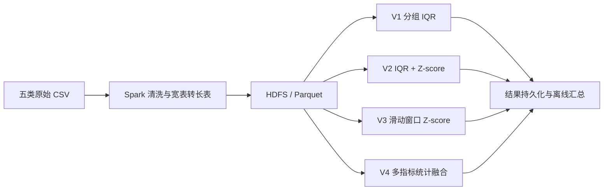
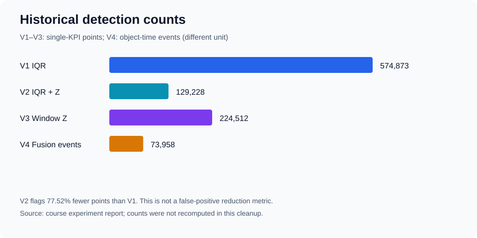

# 基于 Spark 的 AIOps 时序异常检测

使用 **Scala、Spark SQL、HDFS 与 Parquet**，完成运维监控数据清洗、分组统计异常检测、滑动窗口检测和多指标融合实验。

本项目来源于大数据平台课程团队项目。已有实验记录覆盖约 **3.5GB 原始数据、44,972,147 条清洗后记录、五类监控指标**。这些数字是课程实验记录，不是本次整理重新测得的结果。

## 处理流程



## 已实现的能力

- **统一数据格式**：递归读取 CSV，转换数值类型，过滤非法记录，将 service 宽表转换为指标长表，输出按 `metric_type` 分区的 Parquet。
- **四种检测方法**：分组 IQR、IQR 与 Z-score 的 AND/OR 组合、滑动窗口 Z-score、基于 Top-K KPI 的多指标共同异常判断。
- **Spark 执行优化**：按指标类型分批运行、配置 shuffle 分区、在 V2/V3/V4 中持久化重用结果，并将检测与后续结果分析分开。
- **可解释输出**：保存阈值、Z-score、窗口统计量或同时异常的指标数量。

当前实现是离线批处理脚本；Isolation Forest 和前端 Dashboard 不在本仓库已实现功能范围内。

## 实验结果

| 方法 | 记录中的检出数量 | 统计单位 |
|---|---:|---|
| V1 分组 IQR | 574,873 | 单 KPI 异常点 |
| V2 IQR AND Z-score | 129,228 | 单 KPI 异常点 |
| V3 滑动窗口 Z-score | 224,512 | 单 KPI 异常点 |
| V4 多指标融合 | 73,958 | 对象—时间异常事件 |

V2 检出点数较 V1 减少 **77.52%**，表示规则收紧；没有真实异常标签，不能据此声称误报率降低或准确率提高。V4 与前三种方法的统计粒度不同。



详见 [结果及数据来源](docs/results.md)、[方法与参数](docs/algorithms.md) 和 [已知局限](docs/limitations.md)。

## 本地合成样例

准备 Spark **3.5.1 / Scala 2.12**、兼容 Java 环境和 Python 3，并将 `spark-shell` 加入 `PATH`：

```bash
bash scripts/run_demo.sh
```

入口会生成合成数据、运行清洗及四种检测方法，并检查 2,880 条清洗记录与两处注入突刺。每次运行写入独立的 `.demo-runs/run.*` 目录。合成样例用于验证执行流程，不代表真实实验效果。

集群运行方式、输出覆盖行为和输入目录约定见 [复现说明](docs/reproduction.md)。原始课程数据未包含在仓库中。

## 仓库导航

| 路径 | 内容 |
|---|---|
| [scripts/](scripts/) | 清洗、检测、启动和样例验证脚本 |
| [conf/config.example.env](conf/config.example.env) | 不含凭据的配置模板 |
| [examples/](examples/) | 合成数据说明 |
| [docs/architecture.md](docs/architecture.md) | 平台与数据处理架构 |
| [docs/data.md](docs/data.md) | 数据字段、规模与统计口径 |
| [results/summary/](results/summary/) | 从历史实验文档整理的汇总 CSV |
| [docs/contributions.md](docs/contributions.md) | 团队分工与使用说明 |

本次整理的变更及验证记录见 [整理记录](docs/reorganization.md)。
