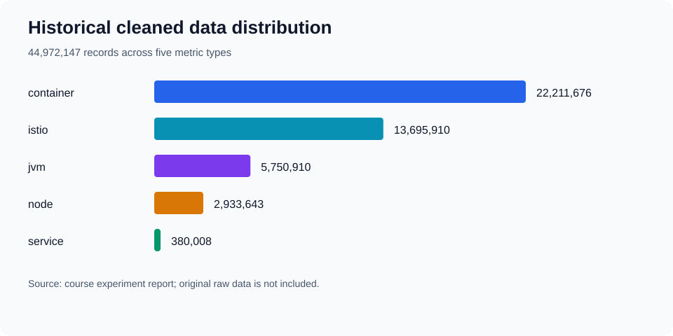

# 历史实验结果

数据来源：原课程 `实验报告.md` 第 2、3 节及 `结果/结果v1.md` 至 `结果v4.md`。原件保留在本地课程归档。以下表格和 CSV 是从这些文档转录的汇总，不是从现有原始 Parquet 重新计算的结果。

| 类型 | 清洗记录数 | V1 异常点 | V2 异常点 | V3 异常点 | V4 事件 |
|---|---:|---:|---:|---:|---:|
| container | 22,211,676 | 238,853 | 40,554 | 108,723 | 27,172 |
| istio | 13,695,910 | 167,447 | 64,184 | 84,068 | 44,784 |
| jvm | 5,750,910 | 85,374 | 12,710 | 6,876 | 153 |
| node | 2,933,643 | 73,792 | 11,144 | 21,260 | 1,743 |
| service | 380,008 | 9,407 | 636 | 3,585 | 106 |
| 总计 | 44,972,147 | 574,873 | 129,228 | 224,512 | 73,958 |

机器可读表格：[historical_counts.csv](../results/summary/historical_counts.csv)。

V1/V2/V3 以清洗记录总数为分母，检出比例分别约为 1.2783%、0.2874%、0.4992%。V2 比 V1 少 77.52% 的检出点，只能解释为规则更严格。

V4 总事件数不能除以单 KPI 记录数作为事件异常率。历史记录仅明确给出了 service 的 feature_row_count=31,680，对应 106 个事件，事件比例约 0.3346%；其余类型的事件分母需从原输出重新提取。因此不再展示旧材料中的 V4 总体 0.164% 异常率。

没有真实标签、独立评测集或耗时日志，不报告 Precision、Recall、F1、误报率下降和加速倍数。单条真实时间序列对比图需取得原始序列与异常输出后再制作。
