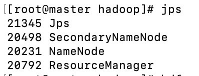
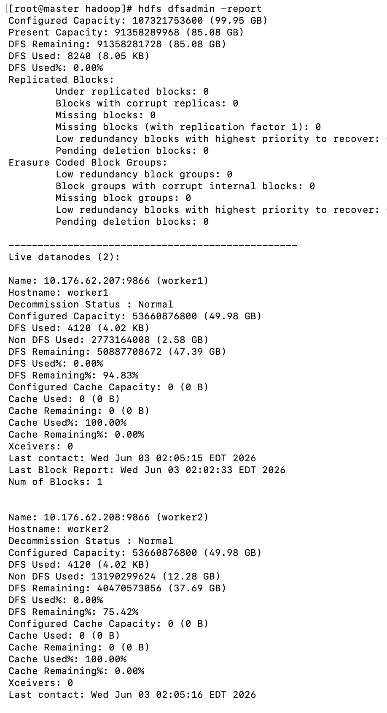

4.2 集群部署结果验证

图4-1 HDFS集群状态信息
（第一张图）

图4-2 HDFS文件系统目录验证
（第二张图）

图4-3 Master节点服务进程
（第三张图）

图 4-3 Master 节点服务进程
通过 jps 命令查看 Master 节点运行的 Hadoop 服务进程。结果显示 NameNode、SecondaryNameNode 和 ResourceManager 均已成功启动，说明 HDFS 与 YARN 核心组件运行正常。

图4-1展示了HDFS集群的运行状态。系统成功检测到2个DataNode节点，副本数配置为2，各节点均正常在线（Live Datanodes），表明HDFS分布式文件系统部署成功。

图 4-2 HDFS 文件系统目录验证
创建测试目录 /test 后，通过 hdfs dfs -ls / 命令查看 HDFS 根目录内容。结果显示目录创建成功，证明客户端能够正常与 NameNode 通信，并完成文件系统元数据操作。